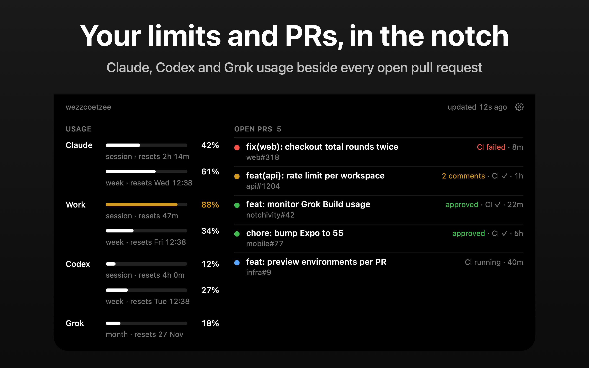
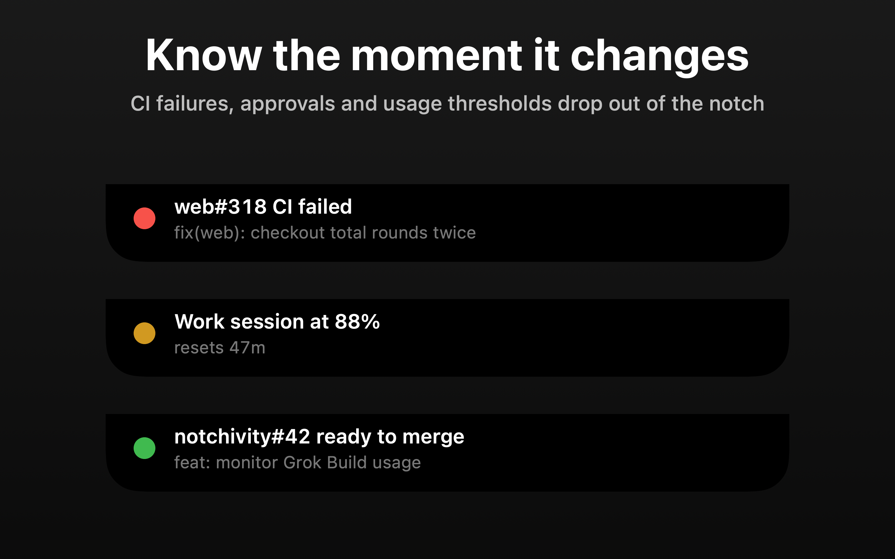
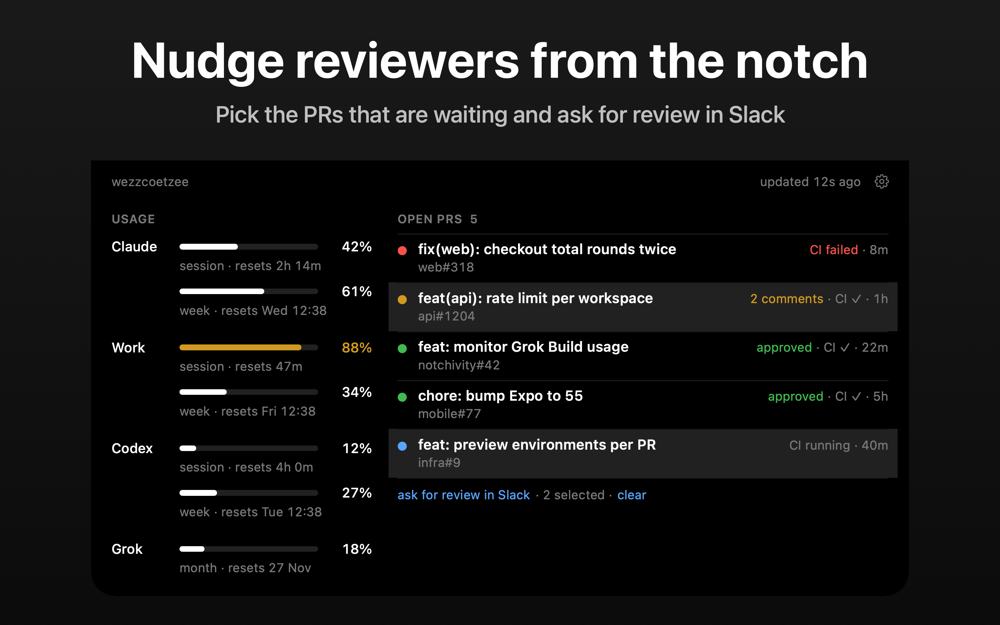
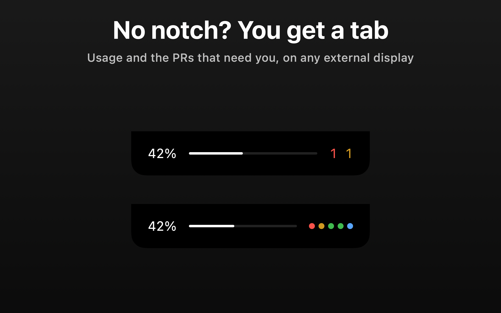
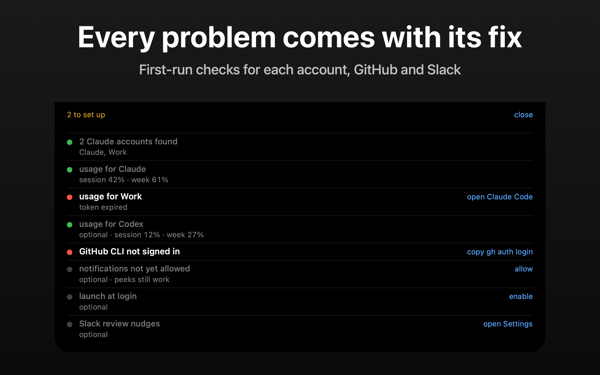

# Notchivity

A macOS notch app that shows Claude, Codex and Grok Build usage across every signed-in account and the status of your open pull requests. Hover the notch to expand it. Events (CI failed, approved, ready to merge, usage thresholds, limit resets) drop a short peek out of the notch and can post to Notification Center.

It replaces three earlier tools: boringNotch (the notch shell), [tokengochi](../tokengochi) (usage) and [pr-tracker](../pr-tracker) (PRs).



## Install

Download the DMG from [Releases](https://github.com/wezzcoetzee/notchivity/releases) and drag Notchivity to Applications.

The app is not notarized, so the first launch shows "Apple could not verify Notchivity". Click Done, then open System Settings, Privacy & Security, and click Open Anyway next to Notchivity. Or clear the quarantine flag:

```sh
xattr -dr com.apple.quarantine /Applications/Notchivity.app
```

## States

| State | When | Shows |
|---|---|---|
| Collapsed | always | On a hardware notch: nothing, the shape matches the notch exactly, except "N to set up" until first-run setup passes. On other displays the black tab shows the usage % with a 2pt underline and the failing and needs-action PR counts (or category dots), each switchable in Displays |
| Peek | for 3 s after an event | One line: what happened, on which PR or account |
| Expanded | while hovered | Accounts with their available usage windows and reset times on the left, open PRs grouped failing → needs action → ready → awaiting review on the right |

Click a PR row to open it. Right-click a row for Open on GitHub and Copy URL and, with Slack set up, Ask for Review in Slack and Select for One Slack Ask. Cmd-click rows (or Select) to pick several, then "ask for review in Slack" under the list sends them as one message; the result shows above that line for a few seconds, and a failure keeps the selection for a retry. Right-click anywhere else for refresh, dismiss peek (while one is up), setup check, settings, quit. When the list is longer than the row limit it ends in a "view all" link (or scrolls, per settings). A row shows its two most urgent flags on the right; any others follow the ref. An amber row always leads with an amber reason ("2 comments", "changes requested", "reviewed", or "draft" on an approved draft). A usage error reads in a few words with its fix as a link under it when there is one ("token expired", then "open Claude Code", which opens Terminal on that account's `CLAUDE_CONFIG_DIR`; if Terminal automation is refused the command is copied instead); hover for the full sentence. A PR fetch error gets the same treatment ("GitHub CLI not signed in" with "copy gh auth login", otherwise "retry", which reads "checking…" until the refetch lands). A transient failure (expired token, network, server error) retries after a minute instead of the full poll interval; rate limits, keychain prompts and missing Grok/Codex snapshots wait the interval.

Click a peek to open what it is about. Hovering a peek waits 600 ms before expanding so the click lands first. Three or more events at once (after sleep, a CI storm) arrive as one peek led by the most urgent ("web#322 CI failed", "+3 more · …"). A peek you hover into counts as seen and does not replay.

## Settings

The gear in the expanded header or the right-click menu opens a standard Settings window.

| Tab | Settings |
|---|---|
| General | Launch at login (needs the app in /Applications), Slack channel and bot token (saved on Return, tab switch, window close or quit), setup check summary and "show on next hover", version |
| PRs | Category order (drag, or right-click a chip for Move Left / Move Right), overflow mode (view all or scroll), rows before overflow, hide drafts, show age |
| Usage | Quota source (local discovery or CLI proxy), poll interval, notification thresholds, account names |
| Notifications | Peek on or off, peek duration, per-event Notification Center toggles |
| Displays | Hover delay, show on external displays (a black tab at the top centre of notch-less screens), what the tab shows (usage on or off and for which account, PR indicator as counts, dots or nothing) |

Cmd-1 to Cmd-5 switch tabs; Cmd-W closes the window.

Slack settings and the CLI proxy URL are written to `~/.config/notchivity/config.json`. The CLI proxy token is stored in macOS Keychain; other preferences live in UserDefaults.

### CLI proxy

In Settings › Usage › Quota source › Configure, enter your [CLI proxy](https://github.com/WebDotNext/cliproxy) base URL and its read-only `USAGE_LIMITS_TOKEN`. The proxy must include [usage-limits support](https://github.com/WebDotNext/cliproxy/pull/10), have management enabled, and permit remote management when Notchivity runs on another machine. Set `USAGE_LIMITS_TOKEN` in the proxy process environment and restart the proxy to enable the scoped token.

When a URL is configured, Notchivity reads `GET /v8/management/usage-limits` instead of discovering local Claude, Codex, or Grok accounts. It shows each supported account separately, maps the proxy's `xai` provider to Grok Build, and preserves unknown percentages and reset times. The proxy omits account names; use the Names rows in Usage to give accounts friendly labels. The regular poll interval still applies, so the first read can show a pending account until the proxy's background refresh completes.

Failed requests retain the last readings with an error; pending and stale observations stay marked until refreshed. Passed reset times do not invent zero usage. An empty successful response removes old accounts. Clearing the URL and saving restores local discovery and removes the stored proxy token. A configured but unreachable or invalid proxy never falls back to local discovery. Setup check and `--doctor` use the selected source too.

## Setup check

On launch the app runs a checklist: Claude sign-in found, usage readable per account, Codex and Grok Build usage when signed in, `gh` installed and signed in, PR query works, plus optional notifications, Slack and launch at login. Until every required item has passed once, hovering the notch shows the checklist instead of the dashboard and the collapsed notch reads "N to set up"; after that, a failing fetch shows as an inline line on the dashboard. Each failing row has a one-click fix and the list rechecks itself every 10 seconds. The header's "close" link always returns to the dashboard: closed while checks still fail, the checklist stays away until relaunch, failures show inline on the dashboard, "N to set up" stays under the notch, and checks rerun every minute so it clears once fixed. Bring it back any time from the right-click menu ("Setup Check") or Settings › General ("show on next hover"); brought back that way it goes away when the panel collapses.

The same checks from the terminal:

```sh
.build/release/Notchivity --doctor
```

Exit code 1 when a required check fails.

## Data

- **Claude usage**: every 3 minutes by default (Settings › Usage), for `~/.claude` and each `~/.claude-*` sibling. The OAuth token is read from the Keychain item Claude Code created (first run shows one "wants to use confidential information" prompt per account; click Always Allow). Token refresh belongs to Claude Code / T3 Code; a 401 means neither has run for a while.
- **Codex usage**: read from disk on the same interval. Codex records its rate limits in the rollout log of every session (`~/.codex/sessions/YYYY/MM/DD/rollout-*.jsonl`), so there is no token and no second caller on OpenAI's API; `primary` is the session window and `secondary` the week. The row only appears when `~/.codex/auth.json` exists. The freshest reading is selected by its event timestamp across all sessions, including older sessions that have resumed. The reading only moves when Codex runs, so the panel says "as of Nh ago" once it is over 15 minutes old, and a window whose reset time has passed reads as empty again.
- **Grok Build usage**: read from `~/.grok/logs/unified.jsonl` on the same interval. Grok Build logs its included credit allowance after billing fetches (including `/usage`). The row appears when `~/.grok/auth.json` exists; credentials are never read and no API requests are made. The freshest timestamp wins, and the last reading survives log trimming while the app runs. Only the actual allowance window is shown: weekly or monthly, including legacy monthly credits. This is the subscription allowance, which can be shared across Grok products, rather than session token counts or API spending. Readings over 15 minutes old show "as of Nh ago". After the recorded period ends, usage becomes unknown until Grok records another snapshot; it is never assumed to be 0%. If no snapshot exists, open `grok` and run `/usage` (update Grok Build if its version does not log billing snapshots). `GROK_HOME` and `GROK_AUTH_PATH` overrides are supported when present in Notchivity's launch environment. Grok checks are optional and never block setup. The log schema follows [Grok Build's billing implementation](https://github.com/xai-org/grok-build/blob/2bdd1d6a6369de0e8c68132ea4539e9abd9e14a8/crates/codegen/xai-grok-shell/src/extensions/billing.rs).
- **PRs**: every 60 seconds via `gh api graphql` for `is:pr is:open author:@me`. Uses your existing `gh auth`.
- PRs refetch when you open the panel if the last fetch is more than a few seconds old. Usage never polls more often than its interval, except that a transient failure (expired token, network, server error) retries after a minute; a rate limit waits the full interval.

## Events

| Event | Peek | Notification Center by default |
|---|---|---|
| CI failed, conflicts, changes requested, approved, ready to merge (an approval that makes a PR ready shows as "ready to merge" alone, unless that notification is off) | yes | yes |
| Usage crossed a threshold (50 / 75 / 90 / 100 by default) | yes | yes |
| New review comments, merged, limit reset, fetch failing | yes | no |

The collapsed underline uses the chosen account's first available window: session for Claude/Codex, or the allowance period for Grok Build.

Usage peeks at 90 %+ mention another account of the same provider when it has headroom. Thresholds fire once per crossing; a reset re-arms them. Nothing fires on the first fetch after launch.

## Slack

Optional. Fill in the channel and token under Settings › General, or create `~/.config/notchivity/config.json`:

```json
{ "slackChannel": "C0123456789", "slackBotToken": "xoxb-…" }
```

Without `slackBotToken` it falls back to `claude -p` and your Slack MCP connection. The first ask posts the PR URL top-level; later asks nudge in that thread. A multi-select ask posts one list message, which becomes the thread for every PR in it.

## Build and run

Needs the full Xcode toolchain: the Command Line Tools lack the SwiftUI macro plugin, so `@State` fails to compile. Run `sudo xcode-select -s /Applications/Xcode.app` once, or prefix commands with `DEVELOPER_DIR=/Applications/Xcode.app/Contents/Developer`.

```sh
swift build -c release
.build/release/Notchivity
```

Notification Center and launch at login need a real bundle:

```sh
./make-app.sh 0.1.0        # → dist/Notchivity.app, Notchivity-0.1.0.dmg, Notchivity-0.1.0.zip
open dist/Notchivity-0.1.0.dmg   # drag to Applications
```

The bundle is ad-hoc signed. On another Mac the first launch needs right-click → Open.

To publish a release, push a version tag from a commit containing `.github/workflows/release.yml`:

```sh
git tag v0.1.0
git push origin v0.1.0
```

The [shared macOS release workflow](https://github.com/wezzcoetzee/.github/blob/main/.github/workflows/macos-release.yml) runs `./make-app.sh` with the tag's version (without `v`) and attaches the DMG and ZIP to a GitHub Release with generated notes. Tags containing a hyphen, such as `v0.1.0-beta.1`, create prereleases. Signing stays ad-hoc; no Apple credentials or notarisation are involved.

`NOTCHIVITY_STATE=expanded` or `=peek` pins the panel open for screenshots; `NOTCHIVITY_SETTINGS=1` opens the Settings window at launch.

## Tests

```sh
swift test
```

Covers account discovery, Codex and Grok usage parsing, CLI proxy requests and quota normalization, snapshot freshness and expiry, setup diagnostics, PR categorisation and GraphQL decoding, and the event diff.

## Formatting

```sh
swift format --in-place --recursive Package.swift Sources Tests scripts
swift format lint --strict --recursive Package.swift Sources Tests scripts
```

Rules live in `.swift-format` (4-space indent, 160 columns). `swift format` ships with the Swift 6 toolchain.

## Layout

```
Sources/NotchivityKit   models, fetchers, EventDiff, SlackNudger (no AppKit)
Sources/Notchivity      NSPanel over the notch, SwiftUI views, AppModel, Notifier
Tests/NotchivityKitTests
```

## Screenshots

<table>
  <tr>
    <td></td>
    <td></td>
  </tr>
  <tr>
    <td></td>
    <td></td>
  </tr>
</table>

These images render the real SwiftUI views offscreen with fixed sample data, so no real accounts or PRs appear:

```sh
swift build && .build/debug/Notchivity --screenshots screenshots
```

That writes the bare views to `screenshots/raw/` and the five App Store images (expanded, peek, nudge, tab, setup), with the headline and background at 2880×1800, to `screenshots/framed/`. Headlines live in `Screenshots.render`.

`--gallery <dir>` renders every state for design review: loading, empty, errors, selection, overflow, setup, the collapsed tab modes, all peeks and each Settings tab. Settings reads `~/.config/notchivity/config.json`, so point `CFFIXED_USER_HOME` at a scratch home to keep your own channel out of the images.
